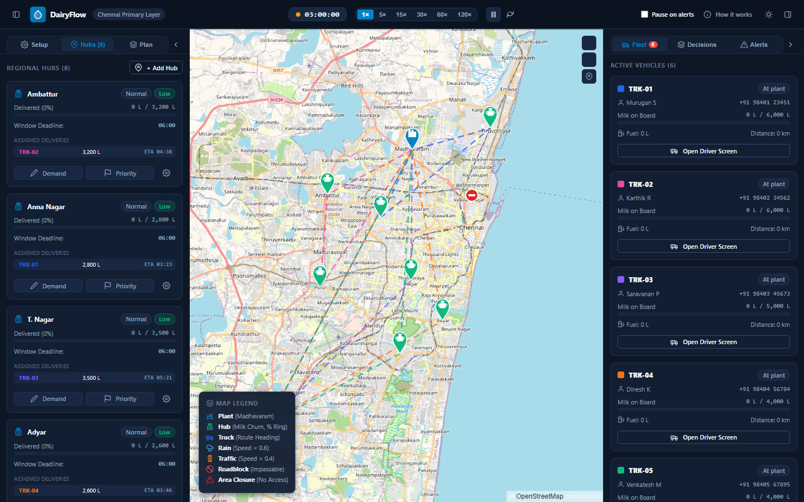
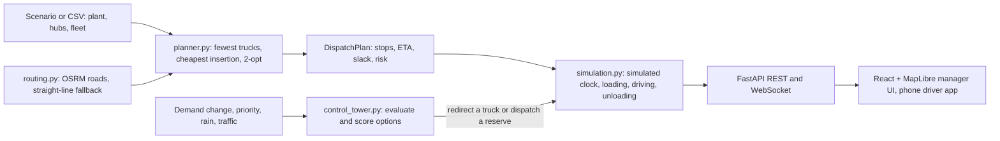

# DairyFlow — Milk Dispatch Control

DairyFlow plans and simulates the **primary milk distribution layer in Chennai**: one processing plant
(Madhavaram) dispatching refrigerated trucks to regional distribution hubs in the early-morning window,
and reacting live when a hub's demand or priority changes. Hub → booth and booth → customer are out of scope.

- **Plan**: covers all demand within plant stock, with the fewest trucks, then the fewest km. Unused trucks stay
  at the plant as reserve, with the reason shown.
- **Simulate**: trucks load, drive real road routes (OSRM), unload, and return; fuel and cost accrue for every km.
- **Control tower**: a demand spike is covered by redirecting a truck already on the road and/or dispatching a
  reserve; every option is evaluated, scored and logged. Auto-apply or manager approval.

**Links:** [GitHub](https://github.com/shriram-s7/diary-flow) · Predecessor: [OptiFlow DRO](https://github.com/shriram-s7/DYNAMIC-ROUTE-OPTIMIZATION-SYSTEM) (DairyFlow grew out of the Dynamic Route Optimization System)



The domain spec and rules are in [`CLAUDE.md`](CLAUDE.md). Backend details and the full API are in
[`backend/README.md`](backend/README.md).

## Run it

Requires Python 3.10+ and Node 18+. Internet access is used for map tiles and OSRM road routes
(if OSRM is unreachable, routes fall back to straight lines at the same speed).

DairyFlow runs **separately from other projects**: its own Python venv (`backend/venv`), its own
`node_modules`, and its own ports — **backend 8600**, **frontend 5600** (not the usual 8000 / 3000 / 5173).
The backend only listens on 127.0.0.1; the browser (and a phone) only talk to the Vite dev server, which proxies
`/api` and `/ws` to the backend, so there is exactly one backend address to get right.

**One command** - the first run also creates the venv and installs packages. The script starts the backend,
waits until it answers `/health`, then starts the frontend:

```bash
start.bat                  # Windows: dev mode, the backend reloads when backend\*.py changes
start.bat --no-reload      # Windows: demo mode, the backend never restarts
./start.sh                 # macOS / Linux (same flags; Ctrl+C stops both)
```

Then open **http://localhost:5600**. **Driver app on a phone** (same Wi-Fi):
`http://<this-PC's-LAN-IP>:5600/driver.html?truckId=TRK-03` (find the IP with `ipconfig` / `ip addr`; on Windows
allow Node.js through the firewall for private networks when asked). Close the two DairyFlow windows to stop.

Different ports: set `DAIRYFLOW_API_PORT` / `DAIRYFLOW_UI_PORT` before running the script. Route cache and logs
live in `.cache/` (`.cache/logs/backend.log`), outside `backend/`, so writing them never triggers a reload.

**By hand**: `cd backend && venv/Scripts/python main.py [--no-reload]`, then `cd frontend && npm run dev`.

Stress test (starts its own backend): `backend/venv/Scripts/python e2e/stress_test.py` (and `--dead-osrm`).

Tests: `cd backend && python -m pytest` (offline). Frontend build check: `cd frontend && npm run build`.

Browser test (needs internet; starts its own servers, so stop yours first):
`backend\venv\Scripts\pip install -r e2e/requirements.txt`, `backend\venv\Scripts\python -m playwright install chromium`,
then `backend\venv\Scripts\python e2e/map_accuracy.py`. It creates 3 hubs by clicking, runs the plan and checks
that every pin is on its road point and every truck stops within 30 m of its hub's pin.

## How it works



Planning and re-planning are deterministic, rule-based heuristics: there is no machine-learning model in this repository. The `timing.py` module is the only place ETA, slack and risk are computed.

## Tech stack

| Layer | Technology |
|---|---|
| Backend | Python, FastAPI, Uvicorn, Pydantic |
| Routing | OSRM public API with straight-line fallback and an on-disk route cache |
| Frontend | React, Vite, MapLibre GL, Axios |
| v2 prototype | SQLAlchemy, Alembic, SQLite, PyJWT (`backend/v2`) |
| Tests | pytest (backend); Playwright-based browser check in `e2e/` |

## Default scenario

Plant: **Madhavaram Plant** (13.1480, 80.2310), **26,000 L** available. Dispatch from **03:00**; every window ends **06:00**.

| Hub | Demand | | Truck | Capacity |
|---|---:|---|---|---:|
| Ambattur | 3,200 L | | TRK-01 | 6,000 L |
| Anna Nagar | 2,800 L | | TRK-02 | 6,000 L |
| T. Nagar | 3,500 L | | TRK-03 | 5,000 L |
| Adyar | 2,600 L | | TRK-04 | 4,000 L |
| Velachery | 3,000 L | | TRK-05 | 4,000 L |
| Porur | 2,400 L | | TRK-06 | 3,000 L (reserve-sized) |
| Tambaram | 3,100 L | | | |
| Tiruvottiyur | 1,800 L | | | |
| **Total** | **22,400 L** | | | **28,000 L** |

The planner uses TRK-01…05 (25,000 L) and keeps TRK-06 in reserve: 195 km planned, every hub before 06:00.

## Formulas

All constants live in `backend/config.py` and the frontend reads them from `GET /config`; each formula is
implemented once (`timing.py`, `planner.py`).

| Quantity | Formula (default values) |
|---|---|
| Speed | `CITY_SPEED_KMPH` = 30 km/h; × `RAIN_SPEED_FACTOR` 0.6 inside a rain zone; × `TRAFFIC_SPEED_FACTOR` 0.5 on a traffic segment |
| Travel time | `distance_km / speed × 60` min (along the road route when known, else straight line) |
| Service time at a hub | `DOCK_TIME_MIN + drop_l / UNLOAD_RATE_L_PER_MIN` = 10 + drop_l / 100 min |
| Loading at the plant | `LOADING_TIME_MIN` = 5 min, finishing at `DISPATCH_START` (03:00) so trucks leave on time |
| Truck load | `min(capacity_l, sum(drops) × (1 + LOAD_BUFFER_PCT/100))`, LOAD_BUFFER_PCT = 5 (also limited by plant stock) |
| ETA | arrival time at the hub: departure + travel + service at earlier stops (minutes from midnight, shown HH:MM) |
| Slack | `window_end − eta` (min) |
| Risk | slack ≥ 30 **Low** · 10–30 **Medium** · 0–10 **High** · < 0 **Late** |
| Fuel | `km / FUEL_KM_PER_L` = km / 5 L, for every km including the return trip |
| Cost | `km × COST_PER_KM` = km × ₹18 |
| Utilisation | `planned drops / capacity_l × 100` % |
| Spike shortage | `new remaining − milk already committed to the hub` |
| Option score | most litres covered → no window broken → least added km |
| Simulation clock | 1× = `SIM_MINUTES_PER_REAL_SECOND` = 1 simulated minute per real second |

## Demo flow

1. **Start** — the app opens with only the plant and the fleet editor. Choose **Start empty** (then click roads on
   the map to add hubs; a click with no road within 300 m is rejected) or **Chennai — 8 regional hubs**.
   In setup you can edit hubs (demand, window, priority), the fleet, or import `backend/sample_data/*.csv`.
2. **Generate Today's Dispatch Plan** — per-truck stops with litres, ETA, slack and risk; utilisation, km, fuel,
   ₹ cost; reserve trucks with reasons; warnings if anything cannot be met.
3. **Dispatch** — trucks load at 02:55 and leave at 03:00. Use the speed slider (top right) to run faster.
4. **Live** — the hub table shows each hub's ETA / slack / risk from the server.
   - **Change demand** on Tambaram: 3,100 → 5,600 L. The control tower evaluates every truck on the road and every
     idle truck, and shows a recommendation card (here: send reserve TRK-06, 2,500 L, no window broken).
     Switch *Demand changes* to **Manager approval** to approve/reject instead.
   - Lower a hub's demand: the freed milk stays on the truck ("Spare") and returns to the plant.
   - Set a hub to **Critical** in *Edit*: its truck serves it next if no other window breaks.
   - **Add Live Impact**: a rain zone, or traffic by clicking a truck's road route. ETAs update.
   - **Follow Truck → Open Driver View**: the driver's next stop, litres to drop, load, ETA, slack and instructions.
5. **Summary** — when every truck is back: litres delivered vs demanded per hub, on-time %, km, fuel, ₹ cost,
   trucks used vs reserve. *Run the same plan again* or start a new scenario.

## Layout

```
backend/   FastAPI service (see backend/README.md); tests in backend/tests; v2/ is the Allocra v2 prototype
frontend/  React + Vite + MapLibre: src/api.js (all calls), src/hooks, src/components, src/DriverView.jsx, src/v2/Platform.jsx
docs/v2/   Allocra v2 specification, decisions, acceptance plan and progress log
e2e/       stress test and browser map-accuracy check
screenshots/  manager and driver screenshots
CLAUDE.md  project spec
```

## Tests

```bash
cd backend
python -m pytest        # offline; OSRM is replaced by straight-line routes
cd ../frontend && npm run build
```

Observed when this README was written: **287 passed, 1 warning** in about 3.5 minutes (this includes the v2 tests). The frontend build, the stress test and the browser test were not run.

## Status and limitations

- **v1 (the app above)** is complete and demo-ready: plan, simulate, control tower, driver app.
- **Allocra v2** (`/platform`, `backend/v2`, `docs/v2`) is **partial**: per `docs/v2/PROGRESS.md`, 4 of 31 planned tasks are complete (P00-P03) with P04 partly done (settings, network, fleet, account management). Setup editors and the machine-learning parts of the spec are still pending, and the v2 gates G1-G7 have not passed. Run it with `start-v2-demo.ps1` and open `http://localhost:5600/platform`.
- State is held in memory; restarting the backend resets the scenario.
- Scope is the plant-to-hub layer for Chennai only. Real dairy practices in the v2 defaults are unvalidated assumptions.
- Road routes depend on the public OSRM server; offline it falls back to straight lines.

## License

No license specified.
