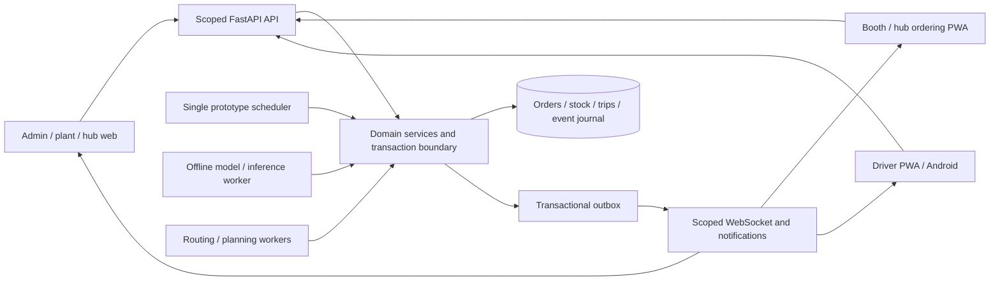

# Target architecture and migration contract

Architecture adopted for prototype-1 in P00; implementation proceeds by gated tasks. All paths below under `backend/v2`, `frontend/src/v2`, `ml` or `mobile` are **future paths**, not claims that modules exist.

## Shape of the system

Keep one modular FastAPI backend and one React application family. Web admin/plant/hub dashboards and booth/hub/driver phone entry points share API contracts, formatting and design tokens. Backend owns quantities, permissions, time, inventory and every transition. Use SQLAlchemy + Alembic with SQLite initially; PostgreSQL compatibility is an explicit later validation check. Prefer a modular monolith over microservices for this scale. ML trains offline and publishes versioned artifacts consumed by a background inference job.

## Module ownership

| Proposed module | Owns | Boundary |
|---|---|---|
| backend/v2/domain | units, packing, priorities, transitions, invariants | Pure calculations; no network, ORM or React. |
| backend/v2/db | SQLAlchemy tables, Alembic, sessions, repositories | Atomic command/unit-of-work; no shared sessions. |
| backend/v2/auth | identity, role grants, scopes, sessions | Every transport uses same policy; demo shortcuts isolated. |
| backend/v2/catalog | network, SKUs, fleet, settings, imports | Effective dates + dispatch snapshots; transactional replace. |
| backend/v2/inventory | lots, movements, reservations, crate custody | Only owner of balance-changing operations. |
| backend/v2/clock | run clock, event journal, scheduler, replay | Calls domain services; does not duplicate workflows. |
| backend/v2/orders | defaults, changes, approval, cut-offs | Uses pinned forecast/settings revision. |
| backend/v2/allocation | fair units allocation + overrides | Does not create inventory or round supply to full crates. |
| backend/v2/planning | Planner protocol, heuristic adapter, manifests | Immutable inputs/results; feasibility reasons first-class. |
| backend/v2/live | motion, disruptions, urgent jobs, scoped snapshots | Revision checked async jobs; shared engine for both levels. |
| backend/v2/delivery | POD, receipt, returns, reconciliation | Idempotent custody/confirmation; inventory via service. |
| backend/v2/communications | threads, notifications, outbox, ack | Scope checked; no external email/SMS requirement. |
| backend/v2/forecasting + ml | inference API, generator, models, metrics | Fixed provenance, honest fallback, no training in API tick. |
| frontend/src/v2 | shells, six roles, forms, calendars, shared maps | Server values; scoped cache; no business formula replicas. |
| frontend/src/v2/offline | IndexedDB trip cache, action queue | Revalidation and conflict UI, not blind replay. |
| mobile/driver | Capacitor wrapper + Android build instructions | Reuses driver surface; real-device acceptance separate. |

## Schema blueprint

All operational rows carry `run_id`, delivery_date where applicable, created/updated audit timestamps, and version for mutable aggregates. Use stable nonsemantic IDs. Uniqueness and foreign keys live in the database, not only validators. Historic documents snapshot names, quantities, packaging, cost rates, forecast/model and settings revisions so edits cannot rewrite old totals.

| Aggregate | Required relations/constraints |
|---|---|
| Plant / Hub / Booth | Hub->plant, booth->home hub required; dated fulfillment assignment stored separately. Raw/snapped location and snap metadata; explicit geography provenance. |
| Product / packaging revision | Dimension ml/g, units/container >0, gross/tare policy, slot factor, returnable container type, lane, shelf life, active. |
| Vehicle / driver / assignment | Source level/home integrity, positive capacities/rates, shifts as dated intervals, lane/compartment rules; no overlapping driver/vehicle trips. Referenced entities deactivate instead of destructive deletion. |
| User / role grant / session | PIN hash only, phone uniqueness/normalization, scope FKs, revocation, demo identity flag. Driver and user linked, no second plaintext PIN field. |
| SimulationRun / Day / Clock | Run isolation, timezone, seed, config revision, clock version. Day lifecycle separate from UI relation past/today/future. |
| ScheduledEvent / Command / Outbox | Unique event key and idempotency key with request hash, committed result, retry/lease state; delivery attempts independent of effect commit. |
| Forecast / model artifact | Unique issuance + booth + SKU + target date/horizon, nonnegative ordered quantiles, feature/data/config versions, generated_at/as_of. |
| DemandObservation | Target/date/booth/SKU/provenance; synthetic truth distinct from sales and accepted delivery. |
| Order / OrderLine / Approval | Unique run/day/level/receiver cycle; suggestion immutable, effective/requested/default revisions separate; approval tied to proposal version. |
| Allocation | SKU/receiver/supply revision/policy; nonnegative bounded units, explicit shortfall; manual reason. |
| InventoryLot / Movement / Reservation | Expiry, usable/quarantine status, location/custody, source command; balanced transfer and unique consumption; prevent over-reservation. |
| Plan / Trip / Stop / ManifestLine | Plan revision/input hash; assigned source/driver/vehicle; per-SKU units/slots/lot reservations, frozen dispatch snapshot, ordered stops, unplanned lines. |
| Route / MotionCheckpoint / Disruption | Geometry hash/cache reference, approximation flag, latest progress/clock, impact geometry, job input revision; restart reconstruction. |
| DeliveryAttempt / POD / confirmation | Stop and manifest version, offered/accepted/refused/damaged disjoint quantities, custody event, challenge hash/expiry/attempts, receiver/driver actor. |
| CrateMovement | Physical returnable type, from/to custody, quantity, command id, reason; balances projected from movements, not SKU slot rounding. |
| Loan / UrgentRequest | Dated scoped request, source/recipient manager acceptance, version and decision; reservations follow accepted service plan. |
| Thread / Message / Ack / Notification | Authorized participants, scoped entity reference, ack deadline/time domain, per-event recipient deduplication. |
| DayClose / adjustment / audit | Immutable reconciliation version and unresolved exceptions; authorized later adjustment, original retained. |

## Proposed API conventions

Add versioned `/api/v2` resources while retaining v1 until replacement passes gates. Existing Vite proxy currently rewrites `/api`; reconcile that explicitly rather than creating `/api/api/v2`. IDs never grant access by themselves. Paged list endpoints accept allowed scope/date filters, not arbitrary database filters.

Mutations carry idempotency key, expected aggregate version and reason where required. Responses expose data, revision, server sim time, wall timestamp and correlation ID. Suggested error semantics: 400 invalid values, 401 unauthenticated, 403 forbidden (or consistent 404 concealment), 404 missing, 409 stale/invalid state, 422 domain constraint details, 429 throttled. Select a consistent 400/422 policy in P01 and document it; v1's 400 handler is not implicitly the v2 contract.

Resource families: `/auth`, `/me`, `/runs`, `/clock`, `/calendar`, `/network`, `/products`, `/fleet`, `/drivers`, `/settings`, `/imports`, `/forecasts`, `/orders`, `/approvals`, `/allocations`, `/inventory`, `/plans`, `/trips`, `/stops`, `/receipts`, `/urgent-requests`, `/loans`, `/disruptions`, `/threads`, `/notifications`, `/reconciliation`. Expose commands for approve/dispatch/confirm rather than allowing arbitrary state-field PATCH.

Long work returns a persisted job ID; query/subscription exposes queued/running/succeeded/failed. Never hold DB transaction or state lock across OSRM, training or a whole route search. Retrying an import/job command returns existing result, not duplicates.

WebSocket envelope: schema version, run_id, scope, monotonically increasing stream sequence, entity revision, sim_time, wall_time, event_type and payload. Reconnect supplies last sequence; server either replays retained events or instructs scoped snapshot resync. Authorization is rechecked after revocation; no broad v1 `/state` leakage to authenticated v2 apps.

## Migration and deployment boundaries

1. Archive v1 behavior spec in tracked documentation; establish tracked v2 spec. Root CLAUDE.md may point to it when implementation begins, but must not be the only source because it is ignored.
2. Build/test v2 domains alongside v1. Avoid adapting v1 live world as the database schema.
3. Seed demo data into a named isolated run. Existing v1 hubs cannot produce a 70-booth network or SKU demands through a lossless conversion; preserve/export v1 separately. Never silently infer SKUs from litres.
4. Integrate screens gradually, reuse theme and road motion, leave legacy navigation available until end-to-end gates pass.
5. Switch default entry point only in P29 after all phase gates. Retain rollback instructions and backup; remove obsolete v1 code in a later explicit cleanup, not during risky migration.

Keep ports 8600/5600 as defaults; configuration remains environment-driven. Add trusted HTTPS only with explicit local setup instructions. No hosting provider is selected and no public deployment is authorized. Model artifacts and operational data should not be silently committed; record manifests/checksums and reproducible generation commands instead. Dependencies must be locked and audited during implementation; this document does not endorse the safety of the old pinned versions.
